# Recycle Online — ระบบจัดการร้านรับซื้อของเก่า

> **สถานะ:** อยู่ระหว่างพัฒนา — ยังไม่ได้ใช้งานจริง (not in production) และยังไม่มีผู้ใช้จริง
> repository นี้เป็น **showcase** ที่คัดมาเพื่อแสดงงาน ไม่ใช่ source code ของระบบ
> (โค้ดจริงอยู่ใน private repository แยกต่างหาก) ภาพหน้าจอทั้งหมดถ่ายจากฐานข้อมูลสาธิต
> ที่ใช้ข้อมูลสมมติ

---

## ปัญหาที่แก้

ร้านรับซื้อของเก่า (เหล็ก ทองแดง กระดาษลัง พลาสติก ฯลฯ) จ่ายเงินสดออกทุกวันตามน้ำหนักที่ชั่ง
งานส่วนใหญ่ยังจดบนกระดาษหรือ Excel ทำให้เกิดปัญหาซ้ำ ๆ :

- คิดเงินผิด / ราคาไม่ตรงกับเกรดของผู้ขาย
- ลานชั่งไม่มีสัญญาณ อินเทอร์เน็ตหลุดบ่อย — ถ้าระบบต้องออนไลน์ตลอดก็ใช้ไม่ได้
- บิลหาย บิลซ้ำ หรือ **จ่ายเงินซ้ำ** เมื่อส่งข้อมูลไม่สำเร็จแล้วกดใหม่
- ตรวจย้อนหลังไม่ได้ว่าใครแก้อะไร ยอดสต็อกและยอดค้างรับไม่ตรงกับความจริง

## ระบบทำอะไร

ออกแบบเป็น SaaS ที่หลายร้านใช้ร่วมกันได้ (multi-tenant) โดยมีร้านรับซื้อของเก่าที่จะเป็นผู้ใช้รายแรก ประกอบด้วย 3 ส่วนที่คุยผ่าน API เดียวกัน:

| ส่วน | เทคโนโลยี | ใช้ทำอะไร |
|---|---|---|
| `server` | FastAPI + PostgreSQL | แหล่งความจริงเดียวและผู้ตัดสินสุดท้าย — (เลขที่บิล, กันบิลซ้ำ, สต็อก, การจ่ายเงิน) |
| `mobile` | React Native + Expo | หน้าลานชั่ง: เปิดบิลรับซื้อ/บิลขาย ทำงานได้แม้ออฟไลน์ (offline-first) |
| `desktop` | Electron + React + TypeScript | หลังร้าน: ดูบิล ยกเลิกบิลพร้อมเหตุผล สต็อก รายงาน สิทธิ์ผู้ใช้ พิมพ์สลิป ESC/POS 58/80 มม. |

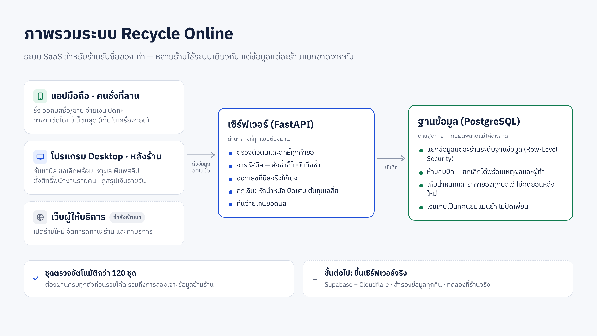

ทั้ง mobile และ desktop ไม่ต่อฐานข้อมูลตรง เซิร์ฟเวอร์เป็นผู้ตัดสินสุดท้ายเสมอ ส่วนมือถือคิดเงินเองได้ตอนออฟไลน์ด้วยกฎชุดเดียวกัน และมีชุดตัวอย่างคำตอบ (golden vectors) ที่ทั้งฝั่ง Python และ TypeScript ต้องคำนวณได้ตรงกันทุกสตางค์

## กฎ 8 ข้อ (เขียนเป็นภาษาคน)

ระบบนี้บันทึก **เงินจริง** ความถูกต้องของข้อมูลจึงมาก่อนทุกอย่าง กฎเหล่านี้ห้ามละเมิด:

1. **เงินและน้ำหนักไม่ใช้ทศนิยมแบบ float** — ใช้ `NUMERIC` ในฐานข้อมูล และเป็นข้อความทศนิยม (decimal string) ตลอดทาง เพื่อไม่ให้สตางค์เพี้ยน
2. **ทุกร้านแยกข้อมูลกันเด็ดขาด** — ทุกตารางมี `tenant_id` และฐานข้อมูลเป็นผู้บังคับเอง (PostgreSQL Row-Level Security) ไม่ใช่พึ่งให้โปรแกรมเมอร์จำใส่เงื่อนไขทุกที่
3. **เลขบิลสร้างที่เครื่อง, เลขที่เอกสารออกโดยเซิร์ฟเวอร์** — มือถือสร้าง UUID เองได้ทันทีแม้ออฟไลน์ ส่วนเลขที่บิลที่คนอ่าน (เช่น `B-2569-5`) ออกตอนส่งถึงเซิร์ฟเวอร์ และหน้าจอบอกชัดว่า "ยังไม่มีเลขที่บิล"
4. **ส่งซ้ำได้โดยไม่เกิดบิลซ้ำ** — ทุกบิลมี `idempotency_key` ถ้าเซิร์ฟเวอร์เจอ key เดิมจะตอบว่า "มีแล้ว" แทนการสร้างใหม่
5. **ไม่ลบรายการเงิน** — บิลผิดต้อง "ยกเลิก" (void) พร้อมเหตุผลและผู้ยกเลิก แล้วออกใบใหม่ ประวัติอยู่ครบ
6. **เก็บตัวเลขที่ใช้คิดเงินไว้ทั้งหมด** — น้ำหนักรวม / ภาชนะ / สุทธิ, ราคาที่ใช้ / ราคาตั้ง และยอดเงินของแต่ละบรรทัด ไม่คำนวณบิลเก่าใหม่จากราคาปัจจุบัน
7. **เวลาเก็บสองค่า** — เวลาตามเครื่อง (`device_created_at`) และเวลาที่เซิร์ฟเวอร์รับ (`server_received_at`) เพราะนาฬิกาเครื่องเชื่อถือไม่ได้
8. **มือถือบันทึกในเครื่องก่อนเสมอ** — ทุกบิลมีสถานะ รอส่ง / ส่งแล้ว / ส่งไม่สำเร็จ และความล้มเหลวต้องมองเห็น ไม่เงียบหาย

## ออฟไลน์แล้วไม่จ่ายเงินซ้ำได้อย่างไร

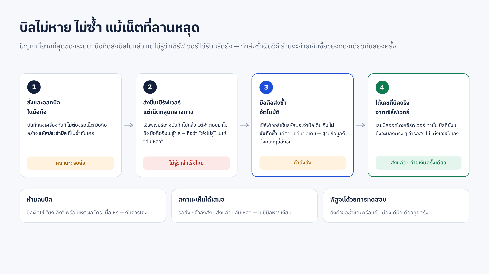

1. ตอนกด "บันทึกบิล" มือถือเขียนบิลลง SQLite ในเครื่องก่อน พร้อมสร้าง `idempotency_key` แบบสุ่ม **ครั้งเดียว** — ไม่สร้างใหม่ตอน retry, ตอนแอปค้าง หรือตอนคำตอบหาย ([excerpt 04](excerpts/04_phone_sync_states.ts))
2. outbox ส่งบิลตามลำดับเวลาที่ชั่ง เมื่อเน็ตกลับมา ถ้าส่งไม่ผ่านจะ backoff แล้วลองใหม่ด้วย key เดิม
3. เซิร์ฟเวอร์ค้นหา key ก่อนทุกครั้ง ถ้าเจอก็คืนบิลเดิม; ถ้าสองคำขอของบิลเดียวกันชนกันพอดี ตัวที่แพ้ race จะถามฐานข้อมูลอีกครั้งแล้วคืนบิลเดิมเช่นกัน ([excerpt 01](excerpts/01_idempotent_bill_create.py))
4. ร้านที่จ่ายเงินที่ตาชั่ง: การจ่ายเงินอัตโนมัติถูกบันทึกใน **transaction เดียวกับบิล** — บิลกับการจ่ายเกิดพร้อมกันหรือไม่เกิดเลย ส่งซ้ำกี่ครั้งก็ได้การจ่ายเดียว
5. ร้านที่แยกเคาน์เตอร์จ่ายเงิน: ทุกการจ่ายมี key ของตัวเอง และยอดที่จัดสรรเข้าบิลรวมกันต้องไม่เกินยอดบิล — ตรวจสองชั้น คือ route ล็อกแถวบิลแล้วตรวจ และ trigger ในฐานข้อมูลตรวจซ้ำ ([excerpt 02](excerpts/02_allocation_cap_guard.py)) ชั้นที่สองถูกเพิ่มหลังจากวัดได้ว่า ถ้าเอาล็อกออก การจ่าย 60.00 สองรายการพร้อมกันกับบิล 100.00 ผ่านทั้งคู่ 4 ใน 5 รอบ

ภาพ [03](docs/images/03_P3_offline_waiting.png) → [04](docs/images/04_P4_synced_doc_no.png) แสดงบิลเดียวกันตอนออฟไลน์ ("รอส่ง", "ยังไม่มีเลขที่บิล") และหลังเน็ตกลับมา ("ส่งแล้ว", `B-2569-5`)

## ทดสอบการแยกข้อมูลแต่ละร้านอย่างไร

- **ชั้นฐานข้อมูล:** ทุกตารางข้อมูลธุรกิจเปิด `FORCE ROW LEVEL SECURITY` พร้อม policy ที่อ่านค่า `app.tenant_id` และแอปตั้งค่านี้ด้วย `SET LOCAL` ภายใน transaction เท่านั้น — จบ transaction ค่าก็หาย connection ที่ถูกนำกลับมาใช้จึงไม่พกร้านเก่าติดไป ไม่ได้ตั้งค่า = เห็นศูนย์แถว (fail closed) ([excerpt 03](excerpts/03_rls_tenant_isolation.py))
- **proof ระดับ SQL:** ต่อฐานข้อมูลจริงด้วย role ของแอป (ไม่ใช่ superuser) สร้างสองร้านที่มีรหัสซ้ำกัน แล้วในนามร้าน A พยายามอ่าน/แก้/ลบ/แทรกข้อมูลร้าน B และลองใช้ connection เดิมโดยไม่ตั้งร้าน ทุกขั้นต้องล้มเหลว ([excerpt 05](excerpts/05_proof_cell_cross_tenant.py))
- **attack matrix ผ่าน HTTP จริง:** ไล่ทุก endpoint จาก `/openapi.json` ที่รับ id ของข้อมูล แล้วให้ admin และ owner ของร้าน B ยิงด้วย id ของร้าน A — ผ่านเมื่อถูกปฏิเสธ, คำตอบไม่มีข้อมูลของ A, และข้อมูลของ A ทุกตารางเหมือนเดิมทุก byte; endpoint ใหม่ที่ไม่มีช่องทดสอบจะทำให้ proof แดงทันที (coverage check) — รอบ 23 ต.ค. 2569: 41 endpoint · 315 กรณี · ข้อมูลรั่ว 0

## แนวทางการทดสอบ

- **proof แทน unit test ลอย ๆ:** แต่ละ proof เป็นโปรแกรมที่รันกับของจริง (PostgreSQL จริง, HTTP จริง, แอป desktop ที่ build แล้ว) แล้วพิมพ์ผลแต่ละ cell และ exit code ของตัวเอง
- **gate รวม (`prove_all`):** คำสั่งเดียวรันทุก proof — ตั้งเซิร์ฟเวอร์ทดสอบและฐานข้อมูล scratch เอง, **รันทุก proof สองรอบ** (กันผลที่ผ่านโดยบังเอิญ), แยกผลเป็น GREEN / RED / COULD-NOT-RUN และไม่นับ "รันไม่ได้" เป็นผ่าน โค้ดเข้า main ได้ก็ต่อเมื่อ gate เขียว
  รอบล่าสุดที่บันทึกไว้ (25 ต.ค. 2569): **128 proofs × 2 รอบ, RED 0**
- **disproof:** proof ที่ไม่เคยแดงก็ไม่รู้ว่าตรวจได้จริง ก่อนจะเชื่อ proof ใหม่ จึงตั้งใจทำให้โค้ดผิด (เช่น เอาล็อกแถวบิลออก) แล้วต้องเห็น proof แดงด้วยเหตุผลที่ถูกต้อง
- **red team:** หลังเขียนเสร็จ มีอีก session ที่อ่านแค่ diff กับกฎของโปรเจกต์ (ไม่อ่านบทสนทนาที่สร้างโค้ด) มีหน้าที่หาทางทำให้การเปลี่ยนแปลงพัง
- **ทดสอบบนอุปกรณ์:** เดินผ่านหน้าจอจริงบน Android emulator และบันทึกเป็นภาพ

## ภาพหน้าจอ (ข้อมูลสมมติ)

| | |
|---|---|
| 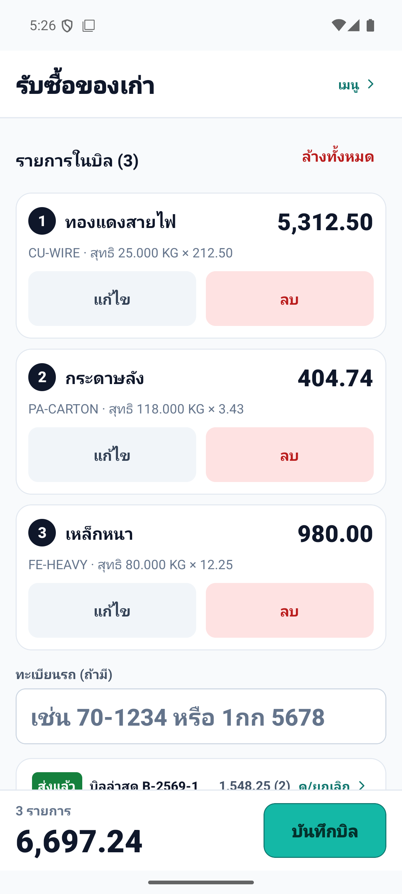 **บิลรับซื้อ** 3 รายการ: น้ำหนักสุทธิ × ราคา | 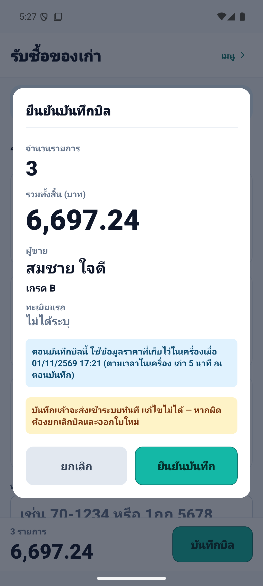 **ยืนยันบันทึกบิล** ก่อนส่ง |
| 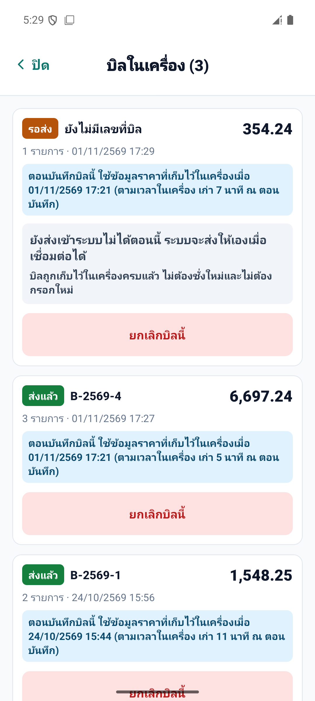 **ออฟไลน์**: "รอส่ง" ยังไม่มีเลขที่บิล | 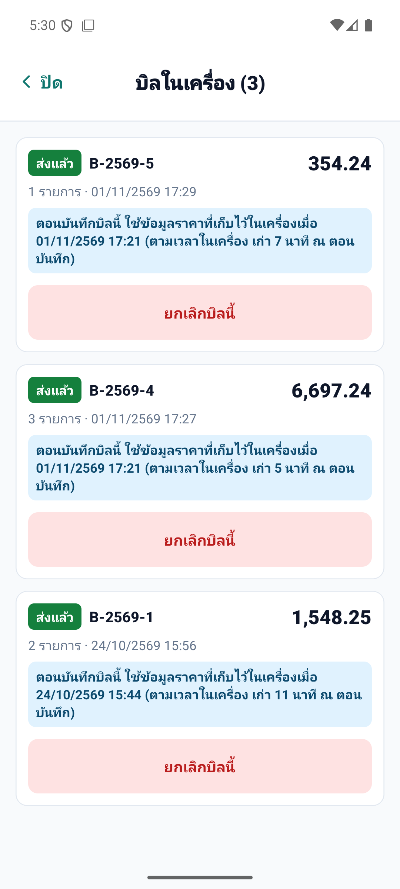 **เน็ตกลับมา**: ส่งแล้ว ได้ `B-2569-5` |
| 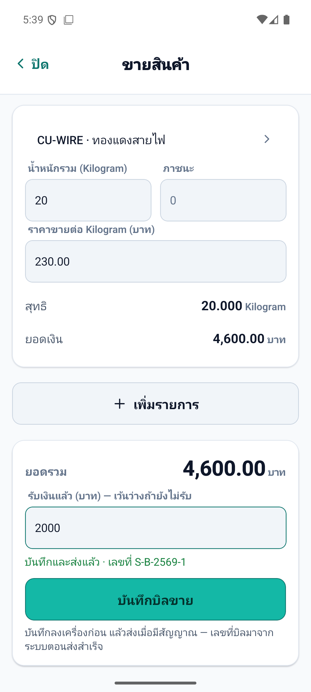 **บิลขาย** (มือถือ): ยอด 4,600 รับแล้ว 2,000 | |

**Desktop (หลังร้าน)**

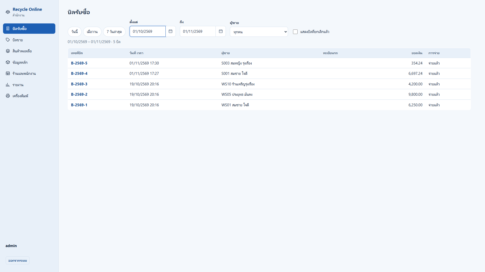
รายการบิลรับซื้อ กรองช่วงวันที่

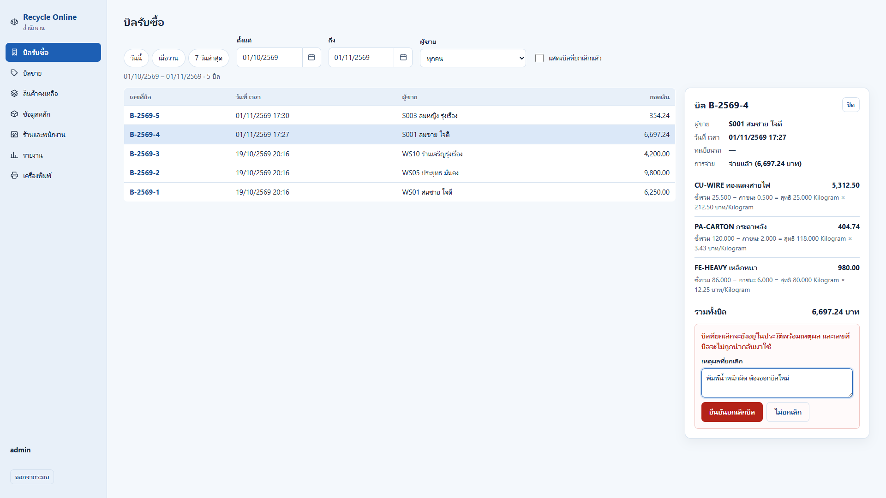
ยกเลิกบิลต้องระบุเหตุผล (ภาพนี้ไม่ได้กดยืนยัน)

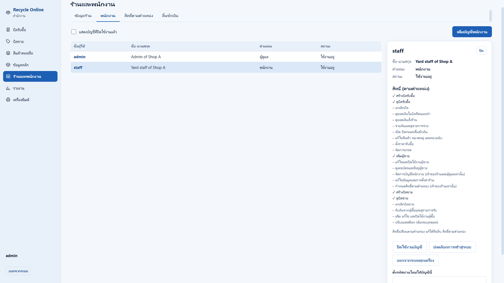
สิทธิ์ของผู้ใช้แต่ละคน (ตามตำแหน่ง)

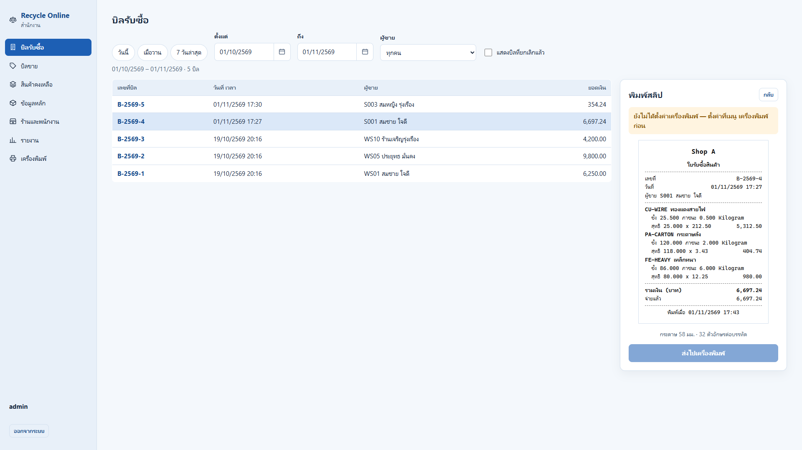
ตัวอย่างสลิป 58 มม. ก่อนส่งเครื่องพิมพ์ thermal

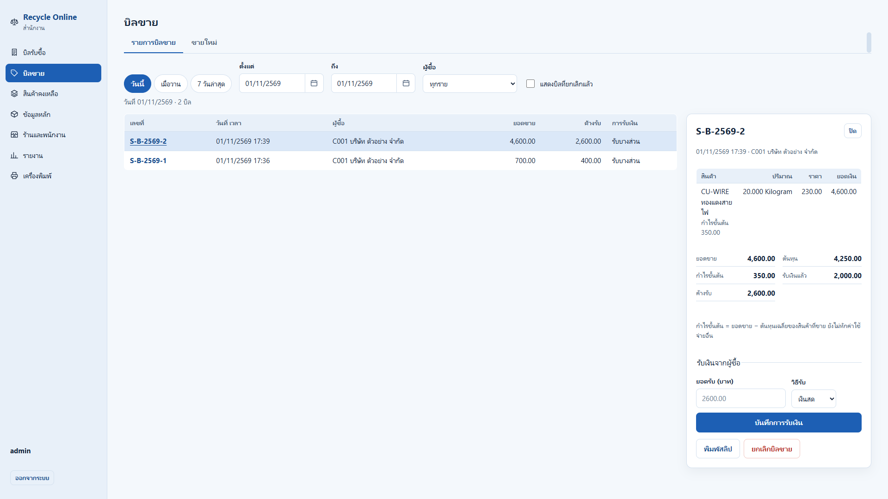
บิลขาย: ต้นทุนเฉลี่ย กำไรขั้นต้น รับแล้ว / ค้างรับ

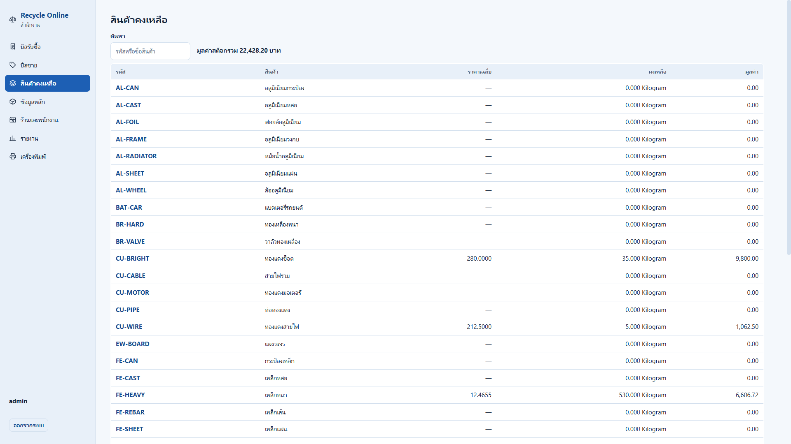
สินค้าคงเหลือและมูลค่าสต็อก (ต้นทุนเฉลี่ย)

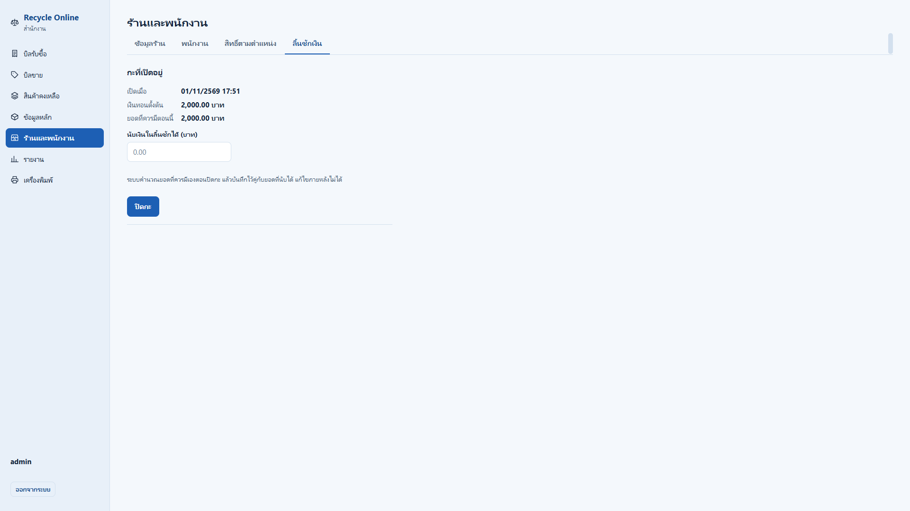
ลิ้นชักเงิน: เปิดกะพร้อมเงินทอนตั้งต้น

## โค้ดตัวอย่าง (excerpts)

ตัดมาสั้น ๆ เพื่อแสดงแนวคิด ไม่ใช่โค้ดที่รันได้เอง หัวไฟล์แต่ละไฟล์บอกไฟล์ต้นทางและบรรทัด

| ไฟล์ | แนวคิด |
|---|---|
| [`01_idempotent_bill_create.py`](excerpts/01_idempotent_bill_create.py) | สร้างบิลแบบ idempotent รวมกรณีส่งซ้ำชนกันพอดี |
| [`02_allocation_cap_guard.py`](excerpts/02_allocation_cap_guard.py) | ยอดจ่ายรวมต้องไม่เกินยอดบิล: ล็อกแถว + ตรวจซ้ำในฐานข้อมูล |
| [`03_rls_tenant_isolation.py`](excerpts/03_rls_tenant_isolation.py) | RLS policy และ `SET LOCAL` ต่อ transaction |
| [`04_phone_sync_states.ts`](excerpts/04_phone_sync_states.ts) | สถานะการซิงก์บนมือถือ และความหมายของคำตอบแต่ละแบบจากเซิร์ฟเวอร์ |
| [`05_proof_cell_cross_tenant.py`](excerpts/05_proof_cell_cross_tenant.py) | proof: ร้าน A พยายามเข้าถึงข้อมูลร้าน B ต้องล้มเหลวทุกทาง |

## บทบาทของผมและการใช้ AI

Code written mainly by AI coding agents (Claude Code) directed by me; I set requirements and rules, prioritised, tested and accepted the work.

(โค้ดส่วนใหญ่เขียนโดย AI coding agents (Claude Code) ภายใต้การกำกับของผม — ผมเป็นคนเก็บความต้องการจากร้านจริง กำหนดกฎของระบบ จัดลำดับงาน ทดสอบ และตรวจรับงาน)
